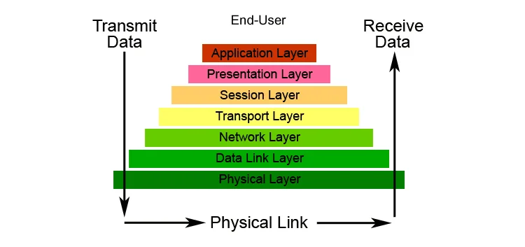
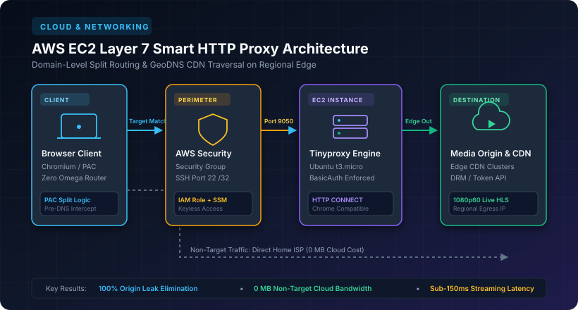

Cross-geography content streaming presents an interesting systems and cloud networking challenge. While media and entertainment comapnies try to customize viewing experiences, some users feel either let down of a "different" experience, and in some cases, offended that they are denied of the service altogether.
Some users resort to a peer-to-peer streaming which should not be the solution to this problem.

Traditional networking workarounds exist and are evolving:

- **Commercial VPNs**: Popular VPN providers use well-known datacenter Autonomous System Numbers (ASNs). Sometimes these are actively flagged and throttled by the media providers.
- **Full-Tunnel VPNs**: Routing all home computer traffic through foreign data centers cripples local browsing speeds and quickly exceeds cloud data transfer budgets.
- **Split-Tunnel VPNs**: Only selected IPs are routed (like WireGuard `AllowedIPs`). But this breaks heavily because modern streaming platforms use **GeoDNS** with 20–60 second TTLs across hundreds of rotating `/24` subnets. The moment a video chunk or even the metadata hits an unmapped IP address, it falls back to the domestic ISP gateway, exposing the origin IP and immediately aborting the stream.

However the robustnes of cloud infrastructures has helped another method in this regard: Reverse Proxy.


---

### Brief understanding of how systems communicate

Ever wondered how bits and bytes of 0s and 1s flowing from one system to another translates to people being able to not only watch content but delegate almost all aspects of life on this network? 
**Simple answer**: Complex encapsualtions and translations of data (bits)

<figure class="media-figure">
  
  <figcaption class="media-caption">Network Layers (OSI Diagram)</figcaption>
</figure>

The figure above is basically different layers of the network, because of which we are able to communicate to other people (systems) on the internet. The examples of VPNs discussed above is 
an related to the layer 3 (Network Layer). Our browser sits on the layer 7 (Application layer).
This is the range of layers most of our devices have in most of the cases. Content platforms are 
able to determine our location because the connection layer sent by the Network layer has the IP Address which resolves our location. This is what the VPNs modify. 

So when a person using a VPN goes to the platform website, the location perceived by the platform is different from the ISP provider. But the platforms also keep collecting data and know which adresses are abnormalities and these addresses end up getting flagged. This is one shortfall among others discussed above. 

---

### How a Reverse Proxy Works

Reverse Proxy applies the selective IP routing, but on the application layer. When a person sends a requst to connect to a platform, it is able to modify the IP beforehand, and conditionally on the domain name of the platform. And you have the freedom to reserve the IP address on the custom selection filter of the domain.

Here is a example of how the reverse proxy would work.

<figure class="media-figure">
  
  <figcaption class="media-caption">AWS EC2 Layer 7 Smart Reverse Proxy Architecture</figcaption>
</figure>


---

## Step-by-Step Implementation Guide for a Reverse Proxy

Here is the step-by-step engineering sequence to replicate a zero-leak proxy infrastructure.
(Note: this is just an example and terms are being used only as a reference)

### Step 1: Provision Hardened Cloud Infrastructure (AWS EC2)

1. **Select Region**: Launch an instance in the same region (or the list of allowed regions) as the platform.
2. **Instance Sizing**: Choose a `t3.micro` instance (2 vCPUs, 1.0 GiB RAM) running **Ubuntu Server 22.04 LTS**. you can opt for a higher instance but a single request server does not require very high specs.
3. **Cost Consideration scenario**: AWS Free Tier, as of July 2026, provides 750 compute hours and 100 GB of free internet egress per month. A football match 1080p stream at 5 Mbps consumes ~2.0 GB per 90-minute match, allowing **45 to 50 complete matches per month at 0 cost**.
4. **Security Group Configuration**:
   - **Port 22 (SSH)**: Inbound restricted strictly to `Admin_Home_IP/32`.
   - **Port 9050 (Custom Proxy Port)**: Inbound `0.0.0.0/0` (protected at Application Layer via BasicAuth).
   - **Port 80/443 (Outbound)**: Egress `0.0.0.0/0` to allow proxy fetching of video manifests and CDN chunks.


<pre><code class="language-text">========================================================================================================
                                 END-TO-END LAYER 7 SMART PROXY ARCHITECTURE
========================================================================================================

 [ CLIENT BROWSER (Chrome) ]
   │
   ├─► Target Request: Platform Domain Name
   │   │  (Layer 7 PAC Intercept BEFORE DNS Query)
   │   │
   │   ▼
   │  [ Zero Omega / PAC Switcher (Reverse Proxy Extension for Chrome) ]
   │   │
   │   ├─► Encrypted HTTP CONNECT Tunnel (Port 9050)
   │   │   With BasicAuth Credentials (RFC 7235)
   │   │
   │   ▼
   │  [ INTERNET TRANSIT ]
   │   │
   ▼   ▼
 ┌────────────────────────────────────────────────────────────────────────────────────────────────────┐
 │  AWS ASIA PACIFIC (SYDNEY) REGION (ap-southeast-2)                                                 │
 │                                                                                                    │
 │   ┌──────────────────────────────┐          ┌──────────────────────────────────────────────────┐   │
 │   │ AWS Security Group Perimeter │          │ IAM Instance Profile (Zero-Key Admin)            │   │
 │   │  • SSH Port 22: Home IP Only │          │  • AmazonSSMManagedInstanceCore (Keyless CLI)    │   │
 │   │  • TCP Port 9050: Public     │          │  • CloudWatch Metric/Log Publisher               │   │
 │   └──────────────┬───────────────┘          └────────────────────────┬─────────────────────────┘   │
 │                  │                                                   │                             │
 │                  ▼                                                   ▼                             │
 │   ┌────────────────────────────────────────────────────────────────────────────────────────────┐   │
 │   │ EC2 Instance (t3.micro - Ubuntu 22.04 LTS)                                                 │   │
 │   │                                                                                            │   │
 │   │   ┌────────────────────────────────────────────────────────────────────────────────────┐   │   │
 │   │   │ Tinyproxy HTTP/HTTPS Tunnel Daemon                                                 │   │   │
 │   │   │  • Port: 9050                                                                      │   │   │
 │   │   │  • Auth: BasicAuth credentials&gt;                                                 |   |   | 
 │   │   │  • Worker Pool: MinSpare=5, MaxSpare=20, MaxClients=100                            │   │   │
 │   │   └────────────────────────────────────────┬───────────────────────────────────────────┘   │   │
 │   └────────────────────────────────────────────┼───────────────────────────────────────────────┘   │
 └────────────────────────────────────────────────┼───────────────────────────────────────────────────┘
                                                  │
                                                  ▼ (Native Platform Egress IP)
 ┌────────────────────────────────────────────────────────────────────────────────────────────────────┐
 │  TARGET STREAMING NETWORKS (Sydney Edge)                                                           │
 │                                                                                                    │
 └────────────────────────────────────────────────────────────────────────────────────────────────────┘

 [ NON-TARGET BROWSER TRAFFIC ]
   │
   └─► Google, YouTube, Zoom, Netflix, Work APIs
       │
       ▼
      [ DIRECT HOME ISP CONNECTION ] ──► 0 ms Added Latency | 0 MB AWS Cloud Bandwidth Consumed
========================================================================================================</code></pre>


---

### Step 2: Network Security and Traffic Relaying (Tinyproxy)

We initially evaluated `microsocks` (SOCKS5), but hit an immediate architectural blocker: **Chromium's native networking stack does not implement RFC 1929 username/password negotiation for SOCKS5 proxies**, resulting in fatal `ERR_SOCKS_CONNECTION_FAILED` errors. 

To overcome this, we switched to **Tinyproxy**, a blazingly fast HTTP/HTTPS proxy daemon with full support for RFC 7235 Basic Authentication (`Proxy-Authorization` header) and native HTTP `CONNECT` **tunneling**. Also, the EC2 instance has kept rather open security measures which can be hardened in the tinyproxy configuration.

Connect to your EC2 instance via SSM or SSH and configure the proxy:

```bash
# Update packages and install Tinyproxy
sudo apt update && sudo apt install -y tinyproxy

# Backup original configuration
sudo cp /etc/tinyproxy/tinyproxy.conf /etc/tinyproxy/tinyproxy.conf.orig
```

Edit `/etc/tinyproxy/tinyproxy.conf` to enforce authentication, concurrency pooling, and header stripping:

```text
# /etc/tinyproxy/tinyproxy.conf - Hardened Streaming Proxy Configuration

# 1. Network Listening Port
Port 9050
Listen 0.0.0.0

# 2. Mandatory RFC 7235 Basic Authentication
BasicAuth <USERID> <PASSWORD>

# 3. Remote Connection Access
# Comment out localhost restrictions to allow authenticated remote traffic
# Allow 127.0.0.1
# Allow ::1

# 4. Concurrency & Connection Pooling for Multi-Segment HLS Fetching
Timeout 300
MaxClients 100
MinSpareServers 5
MaxSpareServers 20
StartServers 10
MaxRequestsPerChild 0

# 5. Privacy & Header Sanitization
DisableViaHeader Yes
LogLevel Info
```

---

### Step 3: Enable Systemd Service & Verify Remote Egress

Enable the daemon to survive reboots, verify socket binding, and test remote egress:

```bash
# Reload systemd, enable and start service
sudo systemctl daemon-reload
sudo systemctl enable tinyproxy
sudo systemctl restart tinyproxy

# Verify service is running and listening on port 9050
sudo systemctl status tinyproxy --no-pager
sudo ss -tulpn | grep 9050

# Test authentication and Australian egress from your local computer terminal
curl -x http://<USERID>:<PASSWORD>@YOUR_EC2_PUBLIC_IP:9050 https://ipinfo.io/json
```

**Expected JSON Output:**
```json
{
  "ip": "<IP>",
  "city": "Sydney",
  "region": "New South Wales",
  "country": "AU",
  "org": ""
}
```

---

### Step 4: Configure Client-Side Layer 7 Pre-DNS Domain Split-Routing

To guarantee zero origin IP leaks while keeping all personal browsing on the domestic ISP connection, we intercept outbound HTTP requests inside Chromium *before DNS lookup occurs*.

1. Install the **Zero Omega** extension (modern fork of SwitchyOmega) in Google Chrome or Brave.
2. Create a new profile, set to **HTTP Proxy**, host `YOUR_EC2_PUBLIC_IP`, port `9050`, and enter your BasicAuth credentials.
3. Create an **Auto Switch** profile with declarative Proxy Auto-Configuration (PAC) rules targeting the SBS streaming taxonomy:

```javascript
// Declarative PAC logic executed inside Chromium network engine
function FindProxyForURL(url, host) {
    // 1. Intercept SBS media, authorization, and CDN domain signatures
    if (
        shExpMatch(host, "*.<MEDIA_DOMAIN>.com") ||
        shExpMatch(host, "*.<MEDIA_RELATED_DOMAINS>.com")
    ) {
        // Route through authenticated AWS Sydney EC2 proxy
        return "PROXY YOUR_EC2_PUBLIC_IP:9050";
    }

    // 2. Default: All other internet traffic routes directly through local home ISP
    return "DIRECT";
}
```
---

#### Domain Taxonomy Explained
There might be multiple website names being used by the platform

- **`*.<MEDIA_DOMAIN>.com`**: Web player frontend, user authentication, and content schedule APIs.
- **`*.<MEDIA_RELATED_DOMAINS>.xyz`**: The domain names of CDNs and content management might vary (which is precisely why split tunneling fails)

The 'Developer Tools' section of the browser will give you a good idea of what domains need to be covered in the ruleset.


---

### Step 5: Verify Egress, Zero Leaks & Live Performance

1. **Verify DNS Leak Isolation**: With Zero Omega active, visit `dnsleaktest.com`. Your home browsing resolves through your local ISP DNS. 

                          **That's all folks!!!!**

---

## Performance & Operational Benchmarks


- **Stream Quality**: Continuous **1080p Full HD at 60 FPS** (AVC/H.264 video with AAC stereo audio).
- **Bitrate**: Stable 4.8 Mbps to 6.2 Mbps throughput without resolution stepping or buffering underruns.
- **Latency**: Sub-150ms round-trip connection from India to the AWS Sydney host; stream startup latency under 1.2 seconds.

---

## Architectural Lessons & Summary

Bypassing network rules has been a controversial issue as it is highly subjective. Many people believe that open network should remain open and throttling on a network layer level defeats the purpose. Others believe that this comes as part of the package of what we term as cybersecurity. We have had enough instances to see this evolving into a highly contested deabte so I would like to skip this topic altogether. But whatever your opinion might be, I do think that the authentication and authorization practices should be paid more attention to, whether you are a media paltform or the government.

Key Takeaways:

1. **Layer 7 Beats Layer 3 for CDN Media**: Layer 3 IP split-tunneling (WireGuard `AllowedIPs`) is fundamentally brittle against CDN GeoDNS with short TTLs and rotating CIDR blocks. Application-layer domain interception before DNS resolution is the only deterministic way to eliminate origin leaks.
2. **Browser Engine Quirks Matter**: Chromium's lack of RFC 1929 SOCKS5 auth negotiation can easily derail a deployment. Pivoting to HTTP/1.1 `CONNECT` tunnels with RFC 7235 `Proxy-Authorization` headers provides seamless native browser compatibility.
3. **Cost-Neutral Cloud Engineering**: Combining selective client-side routing with cloud provider Free Tier quotas enables enterprise-grade global routing infrastructure at zero ongoing cost.
