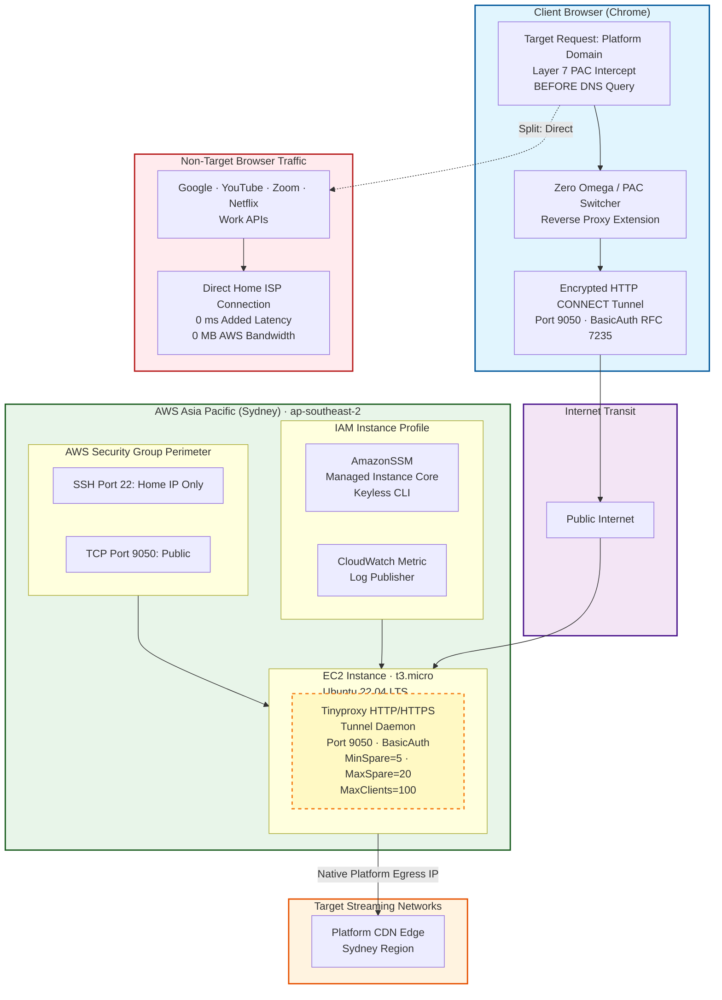
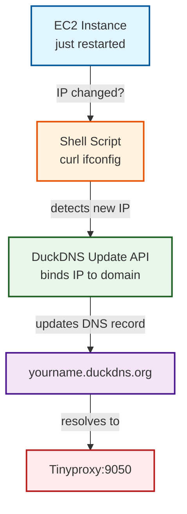

Cross-geography content streaming presents an interesting systems and cloud networking challenge. While media and entertainment companies try to customize viewing experiences, some users feel let down by a "different" experience, and in some cases, offended that they are denied the service altogether.
Some users resort to peer-to-peer streaming, which should not be the solution to this problem.

Traditional networking workarounds exist and are evolving:

- **Commercial VPNs**: Popular VPN providers use well-known datacenter Autonomous System Numbers (ASNs). Sometimes these are actively flagged and throttled by media providers.
- **Full-Tunnel VPNs**: Routing all home computer traffic through foreign data centers cripples local browsing speeds and quickly exceeds cloud data transfer budgets.
- **Split-Tunnel VPNs**: Only selected IPs are routed (like WireGuard `AllowedIPs`). But this breaks heavily because modern streaming platforms use **GeoDNS** with 20–60 second TTLs across hundreds of rotating `/24` subnets. The moment a video chunk or even metadata hits an unmapped IP address, it falls back to the domestic ISP gateway, exposing the origin IP and immediately aborting the stream.

However, the robustness of cloud infrastructure has helped another method in this regard: Reverse Proxy.


---

### Brief understanding of how systems communicate

Ever wondered how bits and bytes of 0s and 1s flowing from one system to another translates to people being able to not only watch content but delegate almost all aspects of life on this network?
**Simple answer**: Complex encapsulations and translations of data (bits).

<figure class="media-figure">
  
  <figcaption class="media-caption">Network Layers (OSI Diagram)</figcaption>
</figure>

The figure above shows the different layers of the network that allow us to communicate with other systems on the internet. The VPN examples discussed above relate to layer 3 (Network Layer). Our browser sits on layer 7 (Application Layer). This is the range of layers most of our devices operate in. Content platforms can determine our location because the connection layer sent by the Network Layer carries the IP address that resolves to a location. This is what VPNs modify.

So when a person using a VPN visits the platform website, the location perceived by the platform differs from the ISP provider. But platforms also collect data and know which addresses are abnormalities, and these addresses end up getting flagged. This is one shortfall among those discussed above. 

---

### How a Reverse Proxy Works

A Reverse Proxy applies selective IP routing, but on the application layer. When a person sends a request to connect to a platform, it can modify the IP beforehand, conditionally on the domain name of the platform. You have the freedom to reserve the IP address on a custom selection filter for the domain.

Here is an example of how the reverse proxy works.

<figure class="media-figure">
  
  <figcaption class="media-caption">AWS EC2 Layer 7 Smart Reverse Proxy Architecture</figcaption>
</figure>


---

## Step-by-Step Implementation Guide for a Reverse Proxy

Here is the step-by-step engineering sequence to replicate a zero-leak proxy infrastructure.
(Note: this is just an example and terms are being used only as a reference)

### Step 1: Provision Hardened Cloud Infrastructure (AWS EC2)

1. **Select Region**: Launch an instance in the same region (or the list of allowed regions) as the platform.
2. **Instance Sizing**: Choose a `t3.micro` instance (2 vCPUs, 1.0 GiB RAM) running **Ubuntu Server 22.04 LTS**. you can opt for a higher instance but a single request server does not require very high specs.
3. **Cost Consideration scenario**: AWS Free Tier, as of July 2026, provides 750 compute hours and 100 GB of free internet egress per month. A football match 1080p stream at 5 Mbps consumes ~2.0 GB per 90-minute match, allowing **45 to 50 complete matches per month at 0 cost**.
4. **Security Group Configuration**:
   - **Port 22 (SSH)**: Inbound restricted strictly to `Admin_Home_IP/32`.
   - **Port 9050 (Custom Proxy Port)**: Inbound `0.0.0.0/0` (protected at the Application Layer via BasicAuth).
   - **Port 80/443 (Outbound)**: Egress `0.0.0.0/0` to allow proxy fetching of video manifests and CDN chunks.

> **⚠️ Important**: EC2 instances that are stopped and started receive a **new public IP address** each time. If you reference the raw IP in your proxy configuration, it will break after every restart. Step 3.5 solves this with DuckDNS dynamic domain binding.


### End-to-End Layer 7 Smart Proxy Architecture




---

### Step 2: Network Security and Traffic Relaying (Tinyproxy)

We initially evaluated `microsocks` (SOCKS5), but hit an immediate architectural blocker: **Chromium's native networking stack does not implement RFC 1929 username/password negotiation for SOCKS5 proxies**, resulting in fatal `ERR_SOCKS_CONNECTION_FAILED` errors.

To overcome this, we switched to **Tinyproxy**, a blazingly fast HTTP/HTTPS proxy daemon with full support for RFC 7235 Basic Authentication (`Proxy-Authorization` header) and native HTTP `CONNECT` tunneling.

Connect to your EC2 instance via SSM or SSH and configure the proxy:

```bash
# Update packages and install Tinyproxy
sudo apt update && sudo apt install -y tinyproxy

# Backup original configuration
sudo cp /etc/tinyproxy/tinyproxy.conf /etc/tinyproxy/tinyproxy.conf.orig
```

Edit `/etc/tinyproxy/tinyproxy.conf` to enforce authentication, concurrency pooling, and header stripping:

```ini
# /etc/tinyproxy/tinyproxy.conf - Hardened Streaming Proxy Configuration

# 1. Network Listening Port
Port 9050
Listen 0.0.0.0

# 2. Mandatory RFC 7235 Basic Authentication
BasicAuth <USERID> <PASSWORD>

# 3. Remote Connection Access
# Comment out localhost restrictions to allow authenticated remote traffic
# Allow 127.0.0.1
# Allow ::1

# 4. Concurrency & Connection Pooling for Multi-Segment HLS Fetching
Timeout 300
MaxClients 100
MinSpareServers 5
MaxSpareServers 20
StartServers 10
MaxRequestsPerChild 0

# 5. Privacy & Header Sanitization
DisableViaHeader Yes
LogLevel Info
```

---

### Step 3: Enable Systemd Service & Verify Remote Egress

Enable the daemon to survive reboots, verify socket binding, and test remote egress:

```bash
# Reload systemd, enable and start service
sudo systemctl daemon-reload
sudo systemctl enable tinyproxy
sudo systemctl restart tinyproxy

# Verify service is running and listening on port 9050
sudo systemctl status tinyproxy --no-pager
sudo ss -tulpn | grep 9050

# Test authentication and Australian egress from your local computer terminal
curl -x http://<USERID>:<PASSWORD>@YOUR_EC2_PUBLIC_IP:9050 https://ipinfo.io/json
```

**Expected JSON Output:**
```json
{
  "ip": "<IP>",
  "city": "Sydney",
  "region": "New South Wales",
  "country": "AU",
  "org": ""
}
```

---

### Step 3.5: DuckDNS Dynamic Domain Binding

Our EC2 server is configured to **auto-shutdown after one hour of zero network traffic** to stay within the AWS Free Tier. When it restarts, AWS assigns a **new public IP address**. If your browser PAC file or any client configuration points to a hard-coded IP, the proxy breaks on every restart.

**DuckDNS** solves this by providing a free dynamic DNS domain (e.g., `yourname.duckdns.org`). A lightweight shell script runs on the EC2 instance (via cron or systemd timer) that:
1. Detects the instance's current public IP.
2. Calls the DuckDNS update API to bind that IP to your domain.
3. Keeps the domain always pointing at the live EC2 IP.

You then reference the **domain** (not the IP) in your PAC rules and Tinyproxy clients, so a restart is transparent.

#### The DuckDNS Auto-Bind Flow




#### Setup

1. **Create a DuckDNS domain** at [https://www.duckdns.org](https://www.duckdns.org) (free, no account required — just log in with a GitHub/Google/Twitter account and create a domain like `aws-smart-proxy`).

2. **Create the update script** on the EC2 instance:

```bash
sudo mkdir -p /opt/duckdns
sudo nano /opt/duckdns/duckdns-update.sh
```

```bash
#!/bin/bash
# /opt/duckdns/duckdns-update.sh
# Binds the current EC2 public IP to your DuckDNS domain

DUCKDOMAIN="yourname"          # your .duckdns.org subdomain
DUCKTOKEN="your-duckdns-token" # token from DuckDNS dashboard

# Fetch current public IP
CURRENT_IP=$(curl -s https://api.ipify.org)

# Fetch the IP DuckDNS currently has on record
RECORDED_IP=$(curl -s "https://www.duckdns.org/update?domains=$DUCKDOMAIN&token=$DUCKTOKEN&ip=" | grep -o 'OK' || echo "NO")

# Only update if the IP changed
if [ "$CURRENT_IP" != "$RECORDED_IP" ] && [ -n "$CURRENT_IP" ]; then
    curl -s "https://www.duckdns.org/update?domains=$DUCKDOMAIN&token=$DUCKTOKEN&ip=$CURRENT_IP"
    echo "$(date): Updated DuckDNS $DUCKDOMAIN.duckdns.org -> $CURRENT_IP" >> /var/log/duckdns-update.log
else
    echo "$(date): IP unchanged ($CURRENT_IP), skipping update" >> /var/log/duckdns-update.log
fi
```

3. **Make it executable**:

```bash
sudo chmod +x /opt/duckdns/duckdns-update.sh
```

4. **Test it manually**:

```bash
sudo /opt/duckdns/duckdns-update.sh
curl https://yourname.duckdns.org
```

5. **Schedule it on boot and periodically**. The safest approach is a systemd service that runs on every boot, plus a cron job as a safety net:

```bash
# systemd service: /etc/systemd/system/duckdns-update.service
sudo nano /etc/systemd/system/duckdns-update.service
```

```ini
[Unit]
Description=DuckDNS Dynamic IP Updater
After=network.target

[Service]
Type=oneshot
ExecStart=/opt/duckdns/duckdns-update.sh

[Install]
WantedBy=multi-user.target
```

```bash
sudo systemctl daemon-reload
sudo systemctl enable duckdns-update.service
```

And a cron entry to re-check every 15 minutes (catches IP changes that occur outside of reboots):

```bash
sudo crontab -e
# Add this line:
*/15 * * * * /opt/duckdns/duckdns-update.sh
```

6. **Verify the domain resolves to your EC2**:

```bash
dig +short yourname.duckdns.org
# Should return your EC2 public IP
```

---

### Step 4: Configure Client-Side Layer 7 Pre-DNS Domain Split-Routing

To guarantee zero origin IP leaks while keeping all personal browsing on the domestic ISP connection, we intercept outbound HTTP requests inside Chromium *before DNS lookup occurs*.

1. Install the **Zero Omega** extension (modern fork of SwitchyOmega) in Google Chrome or Brave.
2. Create a new profile, set to **HTTP Proxy**, host `yourname.duckdns.org`, port `9050`, and enter your BasicAuth credentials.
   - *Using the DuckDNS domain instead of a raw IP means EC2 restarts are transparent — no config changes needed.*
3. Create an **Auto Switch** profile with declarative Proxy Auto-Configuration (PAC) rules targeting the streaming platform's domain taxonomy:

```javascript
// Declarative PAC logic executed inside Chromium network engine
function FindProxyForURL(url, host) {
    // 1. Intercept media, authorization, and CDN domain signatures
    if (
        shExpMatch(host, "*.<MEDIA_DOMAIN>.com") ||
        shExpMatch(host, "*.<MEDIA_RELATED_DOMAINS>.com")
    ) {
        // Route through authenticated DuckDNS-bound EC2 proxy
        return "PROXY yourname.duckdns.org:9050";
    }

    // 2. Default: All other internet traffic routes directly through local home ISP
    return "DIRECT";
}
```

#### Domain Taxonomy Explained
There might be multiple website names being used by the platform

- **`*.<MEDIA_DOMAIN>.com`**: Web player frontend, user authentication, and content schedule APIs.
- **`*.<MEDIA_RELATED_DOMAINS>.xyz`**: The domain names of CDNs and content management might vary (which is precisely why split tunneling fails)

The 'Developer Tools' section of the browser will give you a good idea of what domains need to be covered in the ruleset.


---

### Step 5: Verify Egress, Zero Leaks & Live Performance

1. **Verify DNS Leak Isolation**: With Zero Omega active, visit `dnsleaktest.com`. Your home browsing resolves through your local ISP DNS, while platform traffic exits via the AWS Sydney EC2 proxy.
2. **Confirm DuckDNS binding**: Visit `https://yourname.duckdns.org` from a browser — it should resolve to your live EC2 IP. After an EC2 stop/start cycle, re-run the DuckDNS script (or wait for the cron job) and confirm the IP updates automatically. 


---

## Performance & Operational Benchmarks

- **Stream Quality**: Continuous **1080p Full HD at 60 FPS** (AVC/H.264 video with AAC stereo audio).
- **Bitrate**: Stable 4.8 Mbps to 6.2 Mbps throughput without resolution stepping or buffering underruns.
- **Latency**: Sub-150ms round-trip connection from India to the AWS Sydney host; stream startup latency under 1.2 seconds.
- **EC2 Auto-Shutdown Resilience**: DuckDNS auto-bind ensures zero manual reconfiguration after traffic-based stop/start cycles.

---

## Architectural Lessons & Summary

Bypassing network rules is a controversial topic — it is highly subjective. Many believe open networks should remain open and that throttling at the network layer defeats the purpose. Others see it as part of the package of what we term cybersecurity. We have seen this evolve into a highly contested debate, so I will skip that topic altogether. But whatever your opinion, I do believe authentication and authorization practices deserve attention, whether you are a media platform or a government.

Key Takeaways:

1. **Layer 7 Beats Layer 3 for CDN Media**: Layer 3 IP split-tunneling (WireGuard `AllowedIPs`) is fundamentally brittle against CDN GeoDNS with short TTLs and rotating CIDR blocks. Application-layer domain interception before DNS resolution is the only deterministic way to eliminate origin leaks.
2. **Browser Engine Quirks Matter**: Chromium's lack of RFC 1929 SOCKS5 auth negotiation can easily derail a deployment. Pivoting to HTTP/1.1 `CONNECT` tunnels with RFC 7235 `Proxy-Authorization` headers provides seamless native browser compatibility.
3. **Dynamic DNS Keeps Ephemeral IPs Usable**: EC2 instances that auto-shutdown and restart receive new public IPs. A DuckDNS auto-bind shell script keeps a stable domain pointed at the live IP, making the proxy configuration restart-proof.
4. **Cost-Neutral Cloud Engineering**: Combining selective client-side routing with cloud provider Free Tier quotas enables enterprise-grade global routing infrastructure at zero ongoing cost.
