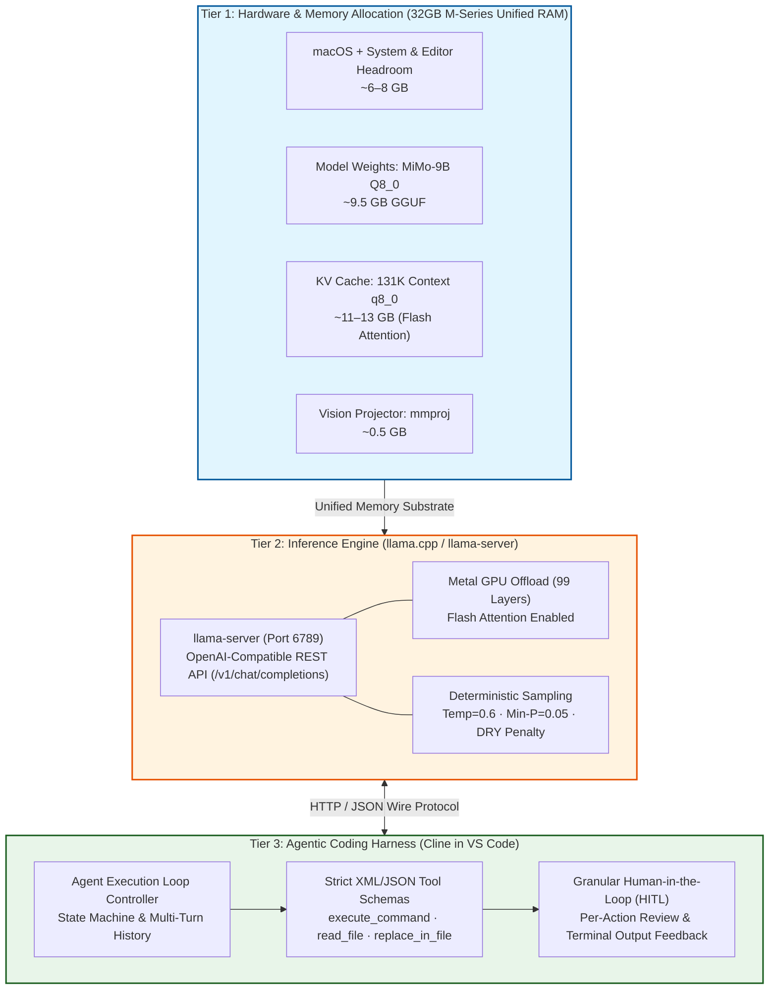
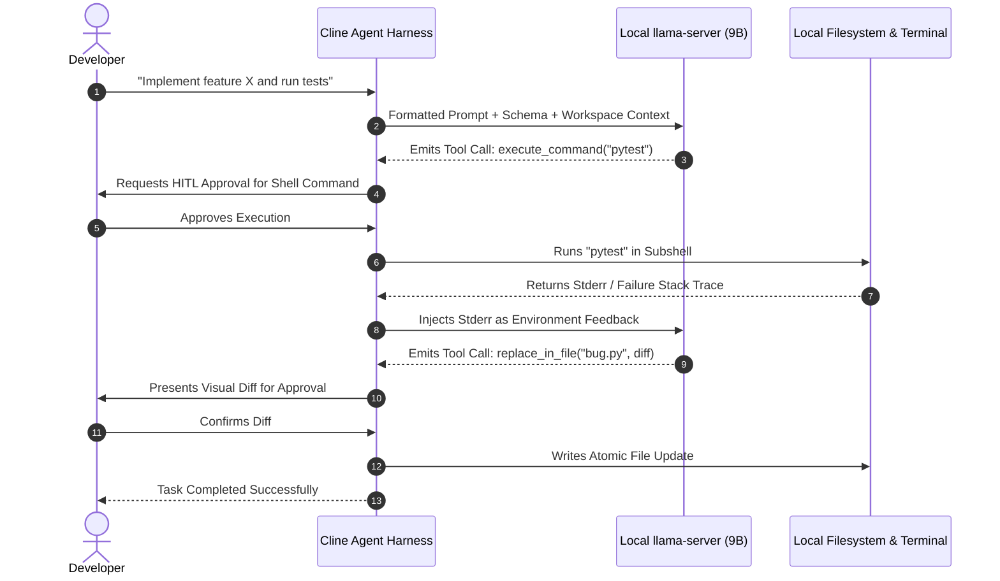

This article is a working checkpoint of a deliberate exercise: convert a **32GB Apple Silicon Mac Mini** into a private, high-throughput inference server that behaves as a first-class OpenAI-compatible endpoint, then wire it to an autonomous coding agent that reliably drives tools against it.

The result is a fully local agentic coding loop with **no per-token billing, zero data egress, and a 131K-token context window** — achieved by treating the stack as three separable tiers: **hardware budget**, **inference engine**, and **agent harness**.

The interesting discovery was never the setup itself. It was learning, through repeated failure, that **the harness matters far more than the model when the model is small**.

---

### The Three-Tier Architecture Overview



---

### 1. The Constraint: 32GB Unified Memory Is the Real Spec

In consumer-grade on-device inference, the binding constraint is never raw CPU clock speed or nominal GPU core counts — it is **unified memory capacity**. Every gigabyte is shared across the operating system, running applications, model weights, key-value (KV) caches, and vision projectors.

| Memory Component | Allocation | Sizing Rationale |
|:---|:---|:---|
| **macOS & System Apps** | 6.0 – 8.0 GB | Required headroom to prevent macOS disk swapping during IDE builds and multitasking. |
| **Model Weights (9B)** | ~9.5 GB | `MiMo-V2.6-Distill-Qwen-9B` quantized at `Q8_0` (near-lossless 8-bit precision). |
| **KV Cache (131K Context)** | 11.0 – 13.0 GB | Headroom for multi-turn agent transcripts with `q8_0` quantized key/value states. |
| **Multimodal Projector** | ~0.5 GB | Vision encoder (`mmproj`) enabling screenshot and diagram ingestion. |
| **Total Footprint** | **~28.0 – 31.0 GB** | **Optimal saturation** of 32GB physical RAM with zero disk swap usage. |

#### Key Takeaway on Memory Pressure
- **The Swap Wall**: The moment memory demand exceeded 32GB and macOS engaged virtual memory swap, token generation throughput collapsed from ~35 tokens/sec to **under 2 tokens/sec**. Avoiding disk swap at all costs is the single most important operational rule.
- **Quantization Sizing**: This constraint rules out frontier-scale 70B+ parameter models on a single machine and forces a disciplined choice: **a 7B–14B class model at high precision (Q8_0 or Q6_K)**, where quantized Metal inference excels.

---

### 2. Engine Selection: Why llama.cpp (and Not Ollama or vLLM)

Three candidate inference runtimes were evaluated against a single-user, on-device developer workflow:

- **vLLM**: The industry standard for high-concurrency cloud GPU clusters. However, on an Apple Silicon machine with concurrency = 1, its PagedAttention advantage provides zero latency benefit, and its CUDA-centric design does not exploit Apple Metal pipelines natively.
- **Ollama**: An approachable developer wrapper that bundles `llama.cpp` underneath. While excellent for quick prototyping, Ollama abstracts away fine-grained sampler knobs, KV cache quantization formats, and context-truncation flags that are mandatory for stabilizing multi-turn agent sessions.
- **llama.cpp (Winner)**: Selected because it provides low-level control over the exact parameters required for agent stability:
  - Explicit **Metal GPU layer offloading** (`-ngl 99`).
  - **Flash Attention** integration for long-context prefill acceleration.
  - **8-bit KV cache quantization** (`--cache-type-k q8_0 --cache-type-v q8_0`), cutting KV memory consumption by 50%.
  - Modern anti-repetition samplers (**DRY** and **Min-P**).
  - First-class, OpenAI-compatible HTTP server (`llama-server`).

---

### 3. Server Configuration: A Reproducible Launch Script

The server is managed via a dedicated shell function that validates file integrity, clears conflicting ports, and configures long-session context parameters in a single invocation:

```bash
start_llama_mimo() {
  local PORT=6789
  local MODEL="$HOME/models/MiMo-V2.6-Distill-Qwen-9B-Q8_0.gguf"
  local MMPROJ="$HOME/models/mmproj-MiMo-V2.6-Distill-Qwen-9B-Q8_0.gguf"

  local CTX_SIZE=131072    # 131K context headroom for deep agent transcripts
  local KV_K="q8_0"        # 8-bit quantized keys: near-f16 quality, half memory
  local KV_V="q8_0"        # 8-bit quantized values
  local TEMP=0.6           # Balanced temperature for deterministic tool invocation
  local TOP_P=0.95
  local TOP_K=20
  local MIN_P=0.05         # Prunes low-probability hallucination branches

  # Clean up any lingering process on the port
  local PIDS=$(lsof -ti :$PORT 2>/dev/null)
  [ -n "$PIDS" ] && { echo "Freeing port $PORT"; echo "$PIDS" | xargs kill -9; sleep 0.5; }

  [ -f "$MODEL" ]  || { echo "Missing model weights: $MODEL";  return 1; }
  [ -f "$MMPROJ" ] || { echo "Missing vision projector: $MMPROJ"; return 1; }

  # caffeinate prevents macOS sleep while the inference daemon is serving
  caffeinate -dimsu llama-server \
    -m "$MODEL" --mmproj "$MMPROJ" \
    --host 0.0.0.0 --port "$PORT" \
    --jinja \
    --ctx-size "$CTX_SIZE" \
    --n-gpu-layers 99 \
    --flash-attn on \
    --cache-type-k "$KV_K" --cache-type-v "$KV_V" \
    --parallel 1 \
    --temp "$TEMP" --top-p "$TOP_P" --top-k "$TOP_K" --min-p "$MIN_P"
}
```

---

### 4. The Agent Harness: Why Cline Outperforms Generic Assistants

In AI-assisted software engineering, **the editor is not just a UI — it is the agent harness**. The harness owns file system operations, terminal execution, diff calculation, permission gates, and conversation state management.



#### 4.1 Comparison: Generic Chat vs. Dedicated Harness

| Capability | Generic Chat Panels (e.g. Copilot Chat) | Basic Integrated Panels (e.g. Zed Assistant) | Autonomous Agent Harness (Cline) |
|:---|:---|:---|:---|
| **Execution Loop** | Single-turn response; no multi-step agency. | Manual user copy-paste of commands. | **Autonomous multi-step loop** driven by goal completion. |
| **Tool Calling with Small Models** | Frequent hallucination and formatting drift. | Unstructured bash suggestions. | **Rigid XML/JSON schema wrappers** optimized for 9B models. |
| **Error Recovery** | User must manually paste error messages. | No closed feedback loop. | **Automatic stderr injection** allowing agent self-healing. |
| **Safety Governance** | Read-only file inspection. | All-or-nothing execution. | **Granular, per-action Human-in-the-Loop (HITL)** approval gates. |
| **Context Compaction** | Silent truncation causing amnesia. | Manual context reset required. | **Intelligent sliding window & transcript summarization**. |

#### 4.2 Why Cline Succeeds Where Other Tools Fail on 9B Models

A compact 9B parameter model is an unforgiving test of a harness: any ambiguity in instructions or error reporting causes the model to derail. Cline is engineered around this constraint:

1. **Deterministic Tool Schema**: Rather than relying on fragile zero-shot JSON tool-calling, Cline uses unambiguous XML-tagged boundaries (`<execute_command>`, `<replace_in_file>`, `<read_file>`). This provides tight syntactic rails that small models follow reliably.
2. **Closed Self-Correction Loops**: When a bash command fails with exit code 1 or a file replacement fails fuzzy matching, Cline does not crash. It injects the raw command output and stack trace directly back into the next model turn, enabling the 9B model to diagnose and self-correct its own mistake.
3. **Model-Specific Prompt Adaptations**: Cline dynamically adjusts its system instructions based on model capability tiers, stripping away complex abstract instructions in favor of concrete step-by-step reasoning prompts suitable for local models.
4. **Human-in-the-Loop as a Fault Tolerance Mechanism**: Per-action approval is not simply security — it prevents catastrophic cascades. If a 9B model proposes an incorrect terminal flag or file path, the developer can reject that individual step, keeping the rest of the conversation context intact.

> **Key Architecture Principle**: In autonomous systems, **Agent = Model + Harness**. When a local agent fails, upgrading the model parameter count rarely solves the root issue — hardening the harness nearly always does.

---

### 5. Architectural Glossary & Working Terminology

A reference glossary of core concepts governing local inference and agent design:

| Term | Domain | Definition & Engineering Significance |
|:---|:---|:---|
| **Inference Engine** | Runtime | The execution software that loads quantized model weights into memory and executes the forward tensor pass to emit tokens (e.g., `llama.cpp`, `vLLM`). It does not manage file edits, terminal tasks, or agent memory. |
| **GGUF** | Format | The binary container format created by `llama.cpp` that packages model weights, tokenizers, tensor metadata, and Jinja chat templates into a single portable file. |
| **Quantization** | Weights | Compressing floating-point weights (e.g., FP16 down to 4-bit `Q4_K_M` or 8-bit `Q8_0`) to shrink RAM footprint and increase memory bandwidth throughput. |
| **KV Cache** | Memory | The working memory holding Key and Value attention tensors for all processed tokens. Its size scales linearly with context length and represents the largest dynamic memory consumer. |
| **Context Window** | Attention | The total token capacity (input prompt + generated completion) the model can attend to at once. Set via `--ctx-size` in `llama-server`. |
| **Flash Attention** | Kernel | An I/O-aware attention algorithm that computes softmax without materializing full attention matrices, slashing memory traffic on Apple Silicon GPU cores. |
| **Chat Template** | Serialization | The Jinja template formatting dialogue turns (`system`, `user`, `assistant`, `tool`) into model-specific control tokens. Faulty templates are the #1 cause of silent tool-calling failures. |
| **Harness** | Control Plane | The autonomous runtime environment that wraps an LLM. It manages the agent loop, parses tool invocations, handles errors, controls memory, and exposes human approval gates (e.g., `Cline`). |
| **HITL** | Safety | **Human-in-the-Loop**: An execution checkpoint that halts autonomous operations to require human approval before applying file modifications or running shell commands. |
| **Min-P Sampling** | Sampler | A dynamic probability threshold sampler that scales with the top token's confidence, cutting off low-probability hallucinations without truncating creative tails. |
| **TTFT / TPOT** | Latency | **Time to First Token** (prefill prompt processing latency) and **Time Per Output Token** (decode token generation rate). |
