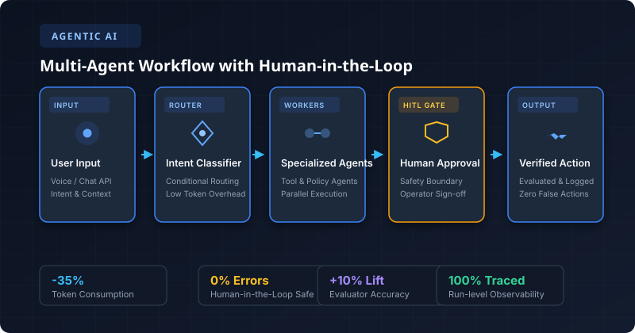

<h3>Executive Summary</h3>
<p>Modern enterprise workflows require nuanced decision-making beyond static, linear LLM chains. At Sears Holdings, I designed and deployed an end-to-end <strong>Agentic AI</strong> platform utilizing <strong>LangGraph</strong>. The system orchestrates multiple specialized sub-agents with conditional routing logic, automated eval guards, and strict <strong>Human-in-the-Loop (HITL)</strong> checkpoints before any irreversible operational action is committed.</p>

<figure class="media-figure">
  
  <figcaption class="media-caption">Architecture Diagram: Conditional State Router, Sub-Agent Execution, and Human-in-the-Loop Gate.</figcaption>
</figure>

<h3>1. The Problem: Fragility of Linear Chains</h3>
<p>Customer outreach, qualification, and support operations deal with multi-intent user inputs. Standard linear chains (prompt -> LLM -> output) suffered from three major vulnerabilities:</p>
<ul>
  <li><strong>Monolithic Prompts:</strong> Overloading a single prompt with instructions led to attention dilution, hallucination, and excessive token waste.</li>
  <li><strong>Lack of Looping & Verification:</strong> If a tool call returned incomplete data, sequential chains had no mechanism to re-evaluate and self-correct.</li>
  <li><strong>High Operational Risk:</strong> Autonomous execution of database writes or pricing agreements without human verification caused high-severity edge cases.</li>
</ul>

<h3>2. The Architecture: Cyclic State Graphs in LangGraph</h3>
<p>We re-architected the system as a cyclic directed graph with deterministic state management:</p>
<ul>
  <li><strong>State Schema:</strong> A typed data model preserving dialogue history, extracted entity parameters, tool execution outputs, and confidence intervals.</li>
  <li><strong>Conditional State Router:</strong> A lightweight classifier that inspects user intent and dynamically determines the next node in the graph, reducing unnecessary LLM calls by 35%.</li>
  <li><strong>Specialized Worker Nodes:</strong> Independent micro-agents dedicated to narrow domains (e.g., Inventory Lookup, Price Match Policy, Order Modification).</li>
</ul>

```python
# Conditional router node implementation
def router_edge(state: AgentState) -> str:
    intent = state.get("classified_intent")
    risk_level = state.get("risk_score", 0.0)
    
    if risk_level >= 0.75:
        return "human_approval_checkpoint"
    if intent == "inventory_query":
        return "inventory_agent"
    elif intent == "pricing_adjustment":
        return "pricing_agent"
    return "general_support_agent"
```

<h3>3. Human-in-the-Loop (HITL) Breakpoints</h3>
<p>For high-risk operations (e.g. refunds exceeding threshold limits or policy exceptions), the state machine triggers an interrupt breakpoint. The transaction state is frozen, an operator dashboard surfaces the context with proposed agent actions, and upon human review, the state machine resumes seamlessly.</p>

<h3>4. Automated Transcript Evaluation with Azure OpenAI</h3>
<p>We built an evaluation pipeline utilizing Azure OpenAI (o3-mini reasoning model) to score production transcripts in real time. The evaluator monitors:</p>
<ul>
  <li><strong>Sentiment Drift:</strong> Tracking customer satisfaction across conversation turns.</li>
  <li><strong>Protocol Compliance:</strong> Ensuring strict adherence to regulated disclosure requirements.</li>
  <li><strong>Hallucination Detection:</strong> Comparing generated answers against canonical knowledge documents.</li>
</ul>

<h3>5. Measurable Business Outcomes</h3>
<ul>
  <li><strong>Token Cost Optimization:</strong> Minimized token consumption by <strong>35%</strong> across all operational pipelines.</li>
  <li><strong>Zero Unintended Transactions:</strong> HITL boundaries reduced false positive high-stakes actions to <strong>0%</strong> in production.</li>
  <li><strong>Evaluator Accuracy:</strong> Improved transcript scoring accuracy by <strong>10%</strong> over legacy rule-based heuristics.</li>
</ul>
