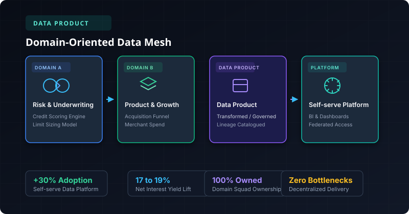

<h3>Executive Summary</h3>

As OneCard grew to millions of transacting cardholders, our centralized data team became a bottleneck for product managers, credit analysts, and marketing operations. I led the architectural transition from a centralized monolithic warehouse to a <strong>decentralized Data Mesh</strong>, treating <em>data as a product</em> and establishing self-serve analytics across all functional business units.

<figure class="media-figure">
  
  <figcaption class="media-caption">Architecture Diagram: Domain Data Ownership, Federated Governance, and Self-Serve Platform Backbone.</figcaption>
</figure>

<h3>1. The Bottleneck: Monolithic Data Engineering</h3>

Previously, all raw event streams (swipes, payments, EMI conversions) flowed into a monolithic warehouse maintained by a single data engineering team. This created critical challenges:

<ul>
  <li><strong>Lack of Domain Context:</strong> Central engineers lacked business context on credit risk underwriting nuances.</li>
  <li><strong>Slow Delivery Cycles:</strong> Product squads waited 2–4 weeks for custom SQL transformations and dashboard modifications.</li>
  <li><strong>Schema Fragility:</strong> Upstream app updates frequently broke downstream financial reconciliation pipelines.</li>
</ul>

<h3>2. The Four Pillars of Our Data Mesh Implementation</h3>
<ol>
  <li><strong>Domain-Oriented Ownership:</strong> We reorganized data ownership along business boundaries: Risk Squad owns credit underwriting tables; Marketing Squad owns engagement logs; Operations owns settlement tables.</li>
  <li><strong>Data as a Product:</strong> Every dataset was packaged with automated schema contracts, documentation, SLA guarantees, and versioned APIs.</li>
  <li><strong>Self-Serve Platform:</strong> We standardized on Snowflake, DBT, and Apache Superset, providing domain squads with declarative templates to build their own pipelines without infrastructure overhead.</li>
  <li><strong>Federated Governance:</strong> Global standards for PII tokenization, data retention, and auditing enforced automatically via CI/CD linting.</li>
</ol>

<h3>3. Realized Data Product: Net Interest Yield Optimization</h3>

Under this new architecture, the Growth squad built a dynamic <em>Interest Yield Data Product</em>. By joining real-time transaction streams with tier pricing models, the team conducted agile pricing experiments that lifted OneCard's net interest yield from <strong>17% to 19%</strong>.

<h3>4. Key Business Results</h3>
<ul>
  <li><strong>Adoption Lift:</strong> Non-technical product managers and analysts increased active feature usage by <strong>30%</strong>.</li>
  <li><strong>Pipeline Autonomy:</strong> Reduced average time-to-insight for new analytics initiatives from 14 days to under 24 hours.</li>
  <li><strong>Audit Compliance:</strong> 100% adherence to financial compliance through automated DBT test suites and schema contracts.</li>
</ul>
