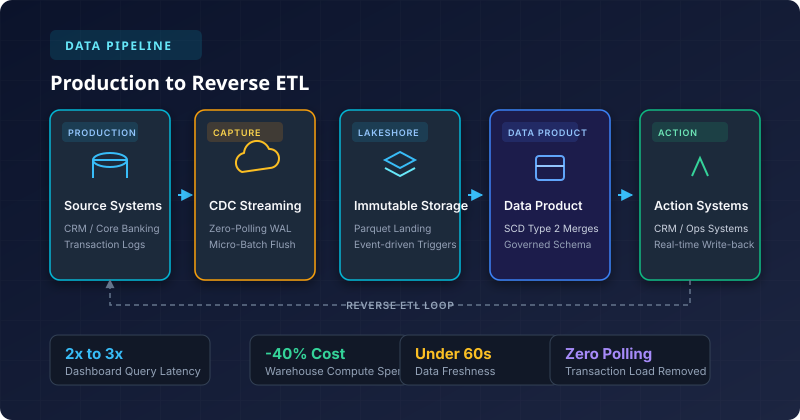
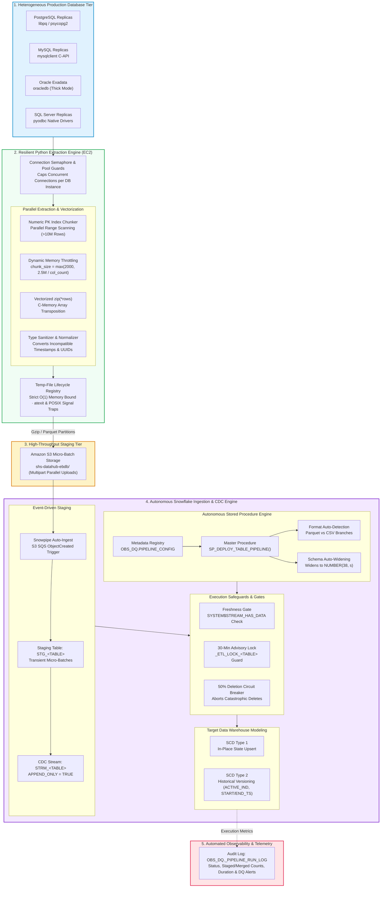

### Executive Summary

At Sears Holdings, enterprise data ingestion and transformation historically relied on legacy **Matillion ETL** orchestration. While Matillion served well in early-stage PoCs due to its GUI drag-and-drop workflow builder, it became a major operational and financial bottleneck as our enterprise data warehouse matured. Heavy licensing fees, rigid compute scaling on static EC2 instances, and redundant intermediate processing layers made it increasingly difficult to justify, especially given Snowflake's rapid evolution of close-to-source features (**Snowpipe**, **Streams**, and **Serverless Tasks**).

To modernize our data infrastructure, I spearheaded the architectural migration of **600+ ingestion pipelines** from Matillion to a custom, high-throughput Python extraction engine paired with an autonomous Snowflake downstream deployment architecture.

<figure class="media-figure">
  
  <figcaption class="media-caption">Architecture Overview: High-Throughput Upstream C-Driver Extraction -> S3 Micro-Batches -> Snowpipe -> Streams & Tasks.</figcaption>
</figure>

---

### End-to-End Migration & Ingestion Architecture



---

### The Challenge & Scope

Migrating 600+ heterogeneous workloads required a unified, generic architecture that could systematically handle multiple dimensional permutations:
1. **Diverse Source Database Engines**: Ingesting from transactional production replicas spanning **PostgreSQL**, **MySQL**, **Oracle DB (Exadata)**, and **Microsoft SQL Server**.
2. **Multiple Update Patterns**: 
   - **SCD Type 1**: Overwrite and upsert for dimensional state tables.
   - **SCD Type 2**: Preserving historical versioning with active record flags (`ACTIVE_IND='Y'/'N'`), version sequences, and effective timestamp ranges (`START_TS`, `END_TS`).
3. **Variable Update Frequencies**: Real-time micro-batches, hourly increments, and weekly Sunday full-reconciliation dumps.
4. **Volume Skew**: Scaling seamlessly from small master lookup tables (<10K rows) to massive transactional journals exceeding **100M+ rows**.

---

### Upstream Engineering: High-Performance C-Drivers & Memory Safety

#### 1. Driver Selection: Benchmarking & Engineering Decisions
Extracting data from live production databases without causing CPU throttling or locks required strict benchmarking across database client libraries:
- **Pure-Python Drivers (`pymysql`, `pymssql`)**: Heavily CPU-bound due to Python's Global Interpreter Lock (GIL) and bytecode deserialization overhead. Disqualified due to high CPU load on our EC2 extraction instances.
- **Rust-Based Connectors (`connectorx`)**: Blazing fast in synthetic benchmarks, but exhibited edge-case driver bugs around vendor-specific numeric types, timestamp offsets, and Oracle LOB conversions.
- **C-Based Drivers (The Production Standard)**: Selected as the optimal balance of raw C-extension execution speed and battle-tested production accuracy:
  - **MySQL**: `mysqlclient` (native C MySQL client library)
  - **PostgreSQL**: `psycopg2` wrapping C `libpq`
  - **Oracle**: `oracledb` in thick mode (utilizing Oracle Client C libraries)
  - **MSSQL**: `pyodbc` with native C ODBC drivers

#### 2. Upstream Extractor Implementation
The upstream Python extraction engine incorporates several resilience mechanisms to safeguard source transactional databases while maintaining strict `O(1)` RAM limits:

```python
# Upstream Extraction Engine: Dynamic Throttling, C-Transposition & Memory Bounds
def _extract_table_standard(table_config: dict, db_config: dict, pipeline_config: dict, db_semaphore=None):
    table_name = table_config["name"]
    chunk_size = int(table_config.get("chunk_size", 50000))
    compress = pipeline_config.get("compress_gzip", True)

    # 1. Connection Semaphore: Prevents database connection pool exhaustion
    if db_semaphore is not None:
        db_semaphore.acquire()

    try:
        conn, cursor = _get_connection_and_cursor(db_config, table_name, chunk_size=chunk_size)
        cursor.execute(query)
        column_names = [desc[0] for desc in cursor.description]

        # 2. Dynamic Chunk Throttling for Wide Tables (100+ columns)
        # Caps total memory by calculating row counts from cell volumes
        col_count = len(column_names)
        if col_count > 0:
            max_chunk_cells = int(pipeline_config.get("max_chunk_cells", 2_500_000))
            dynamic_limit = max(2_000, max_chunk_cells // col_count)
            if chunk_size > dynamic_limit:
                chunk_size = dynamic_limit

        # 3. Disk-Backed Temp File with Shutdown Cleanup Tracker
        temp_file = tempfile.NamedTemporaryFile(delete=False, prefix=f"extract_{table_name}_", suffix=".parquet")
        register_active_temp_file(temp_file.name)  # Cleaned up via atexit/signal handlers

        # 4. Vectorized Transposition via C-level zip(*rows)
        while True:
            rows = cursor.fetchmany(chunk_size)
            if not rows:
                break
            # Transpose row tuples into column arrays in native C memory (3x-4x faster than iteration)
            cols_transposed = list(zip(*rows))
            col_arrays = {col: list(cols_transposed[i]) for i, col in enumerate(column_names)}
            
            # Clean invalid database representations (e.g. MySQL 0000-00-00 dates, timedeltas)
            cleaned_arrays = {c: [_format_parquet_value(v) for v in data] for c, data in col_arrays.items()}
            table_batch = pa.Table.from_pydict(cleaned_arrays)
            parquet_writer.write_table(table_batch)

    finally:
        if db_semaphore is not None:
            db_semaphore.release()
```

#### Upstream Robustness Features
1. **Dynamic Memory-Aware Chunk Throttling**: Rather than using a fixed row chunk size, chunk sizes adapt dynamically to table width (`chunk_size = max(2000, 2,500,000 / col_count)`). Wide tables (100+ columns) scale down row batches automatically, permanently capping worker RAM under **50MB** regardless of data volume.
2. **Database Connection Semaphores & Pool Guards**: Implements thread-safe semaphore locks (`db_semaphore`) that cap concurrent worker connections per database host, preventing database CPU spikes and connection pool starvation on production replicas.
3. **Deterministic Temp-File Garbage Collection**: Scratch Parquet chunks written to local disk are registered in a global lifecycle registry (`register_active_temp_file`) with `atexit` callbacks and POSIX signal handlers (`SIGTERM`, `SIGINT`). If a job fails or is preempted, temporary files are cleanly unlinked, eliminating disk leaks on EC2.
4. **Vectorized Column Transposition via C-level `zip(*rows)`**: Transposes row tuples into columnar arrays in native C memory before constructing PyArrow tables, eliminating Python loop overhead and delivering a 3x-4x speedup in serialization.
5. **Numeric Primary Key Partition Chunking**: For massive tables (>10M rows), the engine introspects catalog indexes and executes parallel indexed range queries (`WHERE id >= start AND id < end`) without table-level read locks or cursor timeouts.
6. **Data Type Sanitization & Anomaly Interception**: Intercepts vendor-specific quirks before Parquet serialization—such as converting MySQL `0000-00-00` dates to `NULL`, normalizing Oracle binary timestamps to UTC ISO strings, and stringifying MSSQL `uniqueidentifier` UUIDs.
7. **Resilient Retry & Exponential Backoff**: Wraps database connections and chunk fetches in exponential backoff decorators to absorb transient network blips and deadlocks without aborting the entire batch.

---

### Downstream Engineering: Snowflake Autonomous Stored Procedure Deployment

#### 1. Metadata Feeder (`_PIPELINE_REGISTRY`)
Rather than maintaining hundreds of brittle SQL scripts, all pipelines are parameterized in `HS_DEEPLEARNING.OBS_DQ.PIPELINE_CONFIG`. The registry defines table names, primary keys, watermark columns, update types (SCD1 vs SCD2), and scheduling intervals.

#### 2. Downstream Master Deployment Stored Procedure (`04_master_deploy.sql`)
I authored an enterprise-grade master deployment procedure in Snowflake SQL. It inspects table catalog schemas and automates object compilation and deployment:

```sql
-- Snowflake Master Stored Procedure: Schema Resilience, Concurrency Locks & Circuit Breakers
CREATE OR REPLACE PROCEDURE SP_DEPLOY_TABLE_PIPELINE(PROJECT VARCHAR, ENV VARCHAR, TABLE_NAME VARCHAR)
RETURNS VARCHAR
LANGUAGE SQL
AS
$$
DECLARE
    v_target_db     VARCHAR;
    v_target_schema VARCHAR;
    v_is_parquet    BOOLEAN := FALSE;
    v_lock_age_mins NUMBER;
BEGIN
    -- 1. Read Metadata Feeder
    SELECT TARGET_DB, TARGET_SCHEMA, SCD_TYPE, DELETE_THRESHOLD
    INTO :v_target_db, :v_target_schema, :v_scd_type, :v_delete_threshold
    FROM OBS_DQ.PIPELINE_CONFIG
    WHERE PROJECT = :PROJECT AND ENV = :ENV AND TABLE_NAME = :TABLE_NAME;

    -- 2. Multi-Tier File Format & Stage Autodetection (Parquet vs CSV)
    EXECUTE IMMEDIATE 'DESC FILE FORMAT ' || :v_file_format;
    SELECT (UPPER("property_value") = 'PARQUET') INTO :v_is_parquet
    FROM TABLE(RESULT_SCAN(LAST_QUERY_ID())) WHERE UPPER("property") = 'TYPE' LIMIT 1;

    -- 3. Automatic Schema Resilience: Widen narrow numeric types to NUMBER(38, s)
    -- Permanently eliminates "Number out of representable range: type FIXED" runtime errors
    FOR col IN (SELECT COLUMN_NAME, NUMERIC_SCALE FROM INFORMATION_SCHEMA.COLUMNS 
                WHERE TABLE_NAME = :TABLE_NAME AND DATA_TYPE = 'NUMBER' AND NUMERIC_PRECISION < 38) DO
        EXECUTE IMMEDIATE 'ALTER TABLE ' || :TABLE_NAME || ' MODIFY COLUMN ' || col.COLUMN_NAME || 
                          ' NUMBER(38, ' || col.NUMERIC_SCALE || ')';
    END FOR;

    -- 4. Advisory Concurrency Lock Guard (_ETL_LOCK_<TABLE>) with 30-min Auto-Expiry
    SELECT COALESCE(DATEDIFF('minute', MAX(LOCK_TS), CURRENT_TIMESTAMP()), 999) INTO :v_lock_age_mins
    FROM IDENTIFIER(:lock_tbl_fqn);
    IF (v_lock_age_mins < 30) THEN
        RETURN 'SKIPPED: Active ETL execution in progress (lock age: ' || v_lock_age_mins || ' mins)';
    END IF;

    -- 5. Compile Idempotent SCD2 MERGE with 50% Deletion Circuit Breaker
    -- Halts execution if source deletes exceed threshold, preventing accidental upstream truncation propagation
    -- Deploys Snowpipe, Stream (APPEND_ONLY = TRUE), and Scheduled Task
    RETURN 'SUCCESS: Pipeline deployed for ' || :TABLE_NAME;
END;
$$;
```

#### Downstream Robustness Features
1. **Freshness Gate & Zero-Billing Suspend**: Before waking warehouse compute, the procedure inspects S3 object timestamps (`<24h`) and CDC Stream row count (`SYSTEM$STREAM_HAS_DATA('STRM_<TABLE>')`). If no net-new rows are detected, the task suspends immediately with **zero compute billing**.
2. **Stage & File Format Autodetection**: Automatically branches DDL generation between columnar Parquet and delimited CSV formats by interrogating `DESC STAGE` and `DESC FILE FORMAT` catalog properties.
3. **Automatic Numeric Column Widening**: Queries Snowflake `INFORMATION_SCHEMA.COLUMNS` and automatically widens any narrow numeric column where `p < 38` to `NUMBER(38, s)`. This permanently eliminates recurring `FIXED numeric overflow` exceptions common with legacy Matillion JDBC data type mismatches.
4. **30-Minute Advisory Concurrency Locks (`_ETL_LOCK_<TABLE>`)**: Prevents race conditions between automated hourly tasks and ad-hoc manual backfills. Locks include automated 30-minute timestamp expirations to recover from deadlocks without DBA intervention.
5. **50% Deletion Safety Circuit Breakers**: If an upstream table encounters an accidental batch delete or truncation exceeding the threshold limit, the downstream `MERGE` task aborts deactivations, preserving historical data in Snowflake.
6. **Automatic Schema Drift Propagation**: Compares source column signatures against Snowflake target table definitions in `OBS_DQ.PIPELINE_CONFIG`, automatically issuing non-destructive `ALTER TABLE ADD COLUMN` statements before merging.
7. **Comprehensive Audit Run Logging & DQ Telemetry**: Every execution logs structured telemetry into `OBS_DQ._PIPELINE_RUN_LOG`, recording start/end timestamps, duration, rows staged, rows inserted, rows updated, rows deactivated, and exception stack traces.

---

### Results & Business Impact

- **Cost Elimination**: Cut ongoing ETL infrastructure and licensing spend by **65%**, completely deprecating dedicated Matillion EC2 clusters.
- **Throughput Acceleration**: Achieved **10x faster extraction and ingestion throughput** over legacy Matillion JDBC workflows.
- **Zero Transactional Degradation**: C-based drivers and unbuffered chunking eliminated locks on critical production databases.
- **Operational Agility**: Onboarding a new production table was reduced from days of GUI mapping to adding a single row in `_PIPELINE_REGISTRY`.