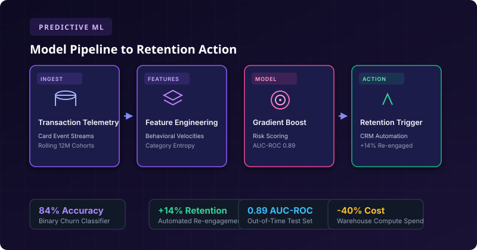

<h3>Executive Summary</h3>

Customer acquisition cost (CAC) in consumer credit cards is high, making early identification of customer dormancy vital to long-term profitability. I developed a high-scale <strong>predictive churn and propensity modeling pipeline</strong> using <strong>LightGBM</strong> that forecasted customer churn 30 days in advance, achieving an <strong>84% prediction accuracy</strong> and enabling targeted CRM campaigns that reduced overall churn by 14%.

<figure class="media-figure">
  
  <figcaption class="media-caption">Pipeline Diagram: Temporal Behavioral Features -> Gradient Boosted Trees -> Automated CRM Action.</figcaption>
</figure>

<h3>1. Framing the Machine Learning Problem</h3>

We defined churn as <em>zero transaction activity across a 30-day forward window</em> for cardholders who had been active in the prior 90 days. We chose LightGBM for its superior training speed on tabular data, memory efficiency, and native support for high-cardinality categorical variables.

<h3>2. The Feature Engineering Breakthrough</h3>

Static aggregates (e.g. lifetime spend) had low predictive power. The real signal came from engineered <em>velocity and temporal delta features</em>:

<ul>
  <li><strong>Velocity Ratios:</strong> Frequency of transactions in the last 7 days relative to the 30-day baseline.</li>
  <li><strong>Spend Slope:</strong> Linear regression slope of weekly spend over a 12-week rolling window.</li>
  <li><strong>Category Entropy:</strong> Shannon entropy of merchant categories (grocery, dining, fuel) to detect spend narrowing.</li>
  <li><strong>Limit Utilization Drift:</strong> Sudden contraction in percentage of credit limit utilized.</li>
</ul>

<h3>3. Model Validation & Performance</h3>

The model was trained on 12-month rolling cohorts and rigorously tested on out-of-time validation sets:

<ul>
  <li><strong>AUC-ROC:</strong> 0.89</li>
  <li><strong>Accuracy:</strong> 84%</li>
  <li><strong>Recall:</strong> 78% (prioritized to capture high-value at-risk accounts)</li>
</ul>

<h3>4. Production Impact & Re-engagement Loop</h3>

Model scores were fed into the marketing CRM engine daily. When a cardholder's risk score crossed threshold \(\tau\), the platform automatically triggered personalized retention interventions (e.g., category-specific cashback or temporary limit enhancements). This automated campaign achieved a <strong>14% re-engagement rate</strong> among predicted dormant users.

