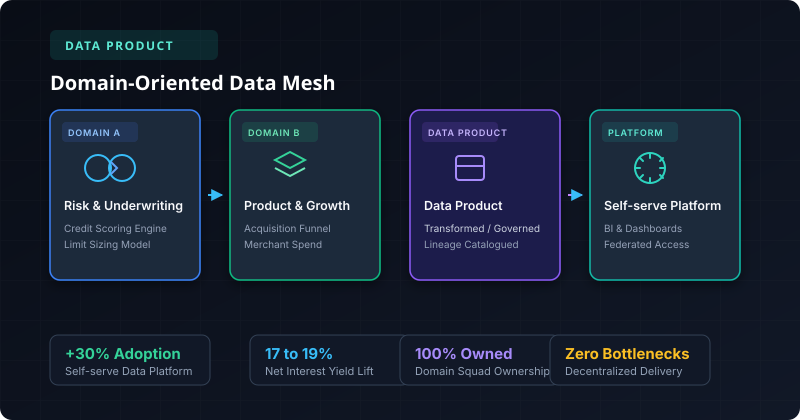

### Executive Summary

As OneCard scaled to millions of transacting cardholders, centralized monolithic databases could no longer sustain sub-second credit risk, fraud, and dynamic limit evaluations during live card swipes. To eliminate engineering bottlenecks and satisfy strict Payment Card Industry (PCI) latency limits, I led a cross-functional group of developers, data engineers, and data analysts to design and launch **OneMatrix**—an enterprise-grade, data-driven decision-making platform built on **Data Mesh architecture** principles.

At its core, OneMatrix functioned as an enterprise **Customer 360 intelligence platform**. It unified all historical swipe transactions, repayment and EMI schedules, delinquency states, and KYC profile changes into a central customer-level data store. A **Central Data Team** provided foundational infrastructure, storage layers, and unified service interfaces, catering autonomously to four distinct business domains:
1. **Revenue Strategy**: Dynamic EMI interest rate optimization and high-margin credit line increases.
2. **Cost Optimization**: Default loss mitigation, fraud chargeback reduction, and interchange fee optimization.
3. **Personalization**: Real-time context-aware merchant offers, rewards, and category spend recommendations.
4. **Customer Experience**: Instantaneous transaction authorization feedback, in-app limit management, and frictionless support routing.

<figure class="media-figure">
  
  <figcaption class="media-caption">Architecture Overview: Domain Data Mesh, Dual-Engine Ingestion (AWS S3 + ClickHouse), Customer 360 Feature Aggregation, and In-Memory Decision Modules.</figcaption>
</figure>

---

### End-to-End OneMatrix Customer 360 Data Mesh Architecture

```mermaid
flowchart TD
    subgraph S1["1. Decentralized Domain Feeds & Event Streams"]
        direction TB
        subgraph S1_Top["Commercial & Growth Domains"]
            direction LR
            D1["Revenue Strategy Domain<br/>• Dynamic EMI APR & Interest Optimization<br/>• High-Margin Credit Line Expansion<br/>• Revolving Balance Spreads & Amortization"]
            D3["Personalization Domain<br/>• Merchant Category Affinities & Profiling<br/>• Contextual Cashbacks & Gamified Drops<br/>• Real-Time Spend Triggers & Category Preferences"]
        end
        subgraph S1_Bottom["Risk & Experience Domains"]
            direction LR
            D2["Cost Optimization Domain<br/>• Real-Time Fraud Velocity Ceilings<br/>• Delinquency State Tracking & DPD Windows<br/>• Interchange Fee Optimization Models"]
            D4["Customer Experience Domain<br/>• Sub-Second Swipe Authorizations<br/>• In-App Dynamic Limit Controls<br/>• Frictionless Escalation & Support Routing"]
        end
        S1_Top --> S1_Bottom
    end

    subgraph S2["2. Dual-Engine Ingestion & Customer 360 Master Tables"]
        direction TB
        subgraph UpstreamIngest["Dual Upstream Ingestion Tier"]
            direction LR
            BATCH["AWS Data Lake (S3) & SageMaker Processing<br/>• Scheduled Multi-Granularity Batch Crons<br/>• 30-Day, 60-Day & 90-Day Rolling Windows<br/>• Historical Repayment & Statement Rollups"]
            STREAM["ClickHouse OLAP Real-Time Database<br/>• Sub-Second Event Stream Ingestion<br/>• High-Velocity 5-Min Swipe Aggregations<br/>• Rapid Consecutive Geo-Location Delta Checks"]
        end
        C360["Unified Customer 360 Master Store<br/>Primary Key: customer_id<br/>Synthesizes Complete Lifetime Swipes, Repayment Timeliness & KYC Profiles"]
        FEAT["Customer-Level Feature Aggregation Engine<br/>Converts Heterogeneous Partitions into Deterministic Behavioral Vectors"]
        UpstreamIngest --> C360
        C360 --> FEAT
    end

    subgraph S3["3. In-Memory Decision Platform (Redis Engine)"]
        direction TB
        RD["Redis Data Layer (Protobuf Store)<br/>Key: features:customer_id<br/>Compact Binary Payloads · Strict Cross-Language Schemas · Sub-1ms Deserialization"]
        subgraph DecEngine["Dynamic On-the-Fly Decisioning Modules"]
            direction TB
            MODELS["Deployed Machine Learning Scoring Models<br/>• Uplift & EMI Propensity Classifiers<br/>• Real-Time Transaction Fraud Risk Models"]
            DROOLS["Drools Rule Engine Policy Modules<br/>• Credit Policy & Regulatory Boundaries<br/>• Underwriting Cutoffs & Margin Rules"]
            TRIG["Redis Keyspace Triggers<br/>Matches Request Context to Active Rule & Model Matrix"]
            MODELS --> TRIG
            DROOLS --> TRIG
        end
        OUT["Redis Output Cache<br/>Key: decision:domain:customer_id<br/>Domain TTLs: 15s (Instant Swipes) · 1h (Dynamic EMI) · 24h (Risk Tiers)"]
        RD --> DecEngine
        DecEngine --> OUT
    end

    subgraph S4["4. High-Throughput Java API Gateway & Consumer Clients"]
        direction TB
        JAVA_API["Java High-Throughput Microservice APIs<br/>Maintained by Core Dev Squad · Strict Data Contracts<br/>Automated Smoke, Contract & Banking Integration Testing"]
        subgraph Consumers["Downstream Consumer Services"]
            direction LR
            AUTH["Card Authorization Host<br/>Sub-15ms Swipe Approvals"]
            APP["OneCard Mobile Client<br/>Dynamic Limit & EMI Banners"]
            BANK["Partner Banking Gateways<br/>Settlement & Ledger Sync"]
        end
        OUT -->|"Sub-15ms Cache Hit"| JAVA_API
        JAVA_API --> Consumers
    end

    subgraph S5["5. Closed Telemetry Feedback & 15-Day Sprint Governance"]
        direction TB
        subgraph TelemetrySub["Operational Telemetry Pipeline"]
            direction LR
            LOGS["Use-Case Performance Log Tables<br/>Asynchronous Capture of Approvals, Defaults & Conversion Rates"]
            DRIFT["Attribution & Signal Drift Engine<br/>Correlates Outcomes to Exact Feature Snapshots at Decision Time"]
            LOGS --> DRIFT
        end
        TAIGA["Taiga Agile Collaboration Platform<br/>15-Day Sprint Cadences Aligning Developers, Data Engineers & Analysts"]
        Consumers -.->|"Asynchronous Execution Telemetry"| LOGS
        DRIFT -.->|"Feature Recalibration & Updates"| C360
        DRIFT -.->|"Backlog Feedback & Model Iterations"| TAIGA
    end

    S1 -->|"Domain Events & Feeds"| S2
    S2 -->|"Sub-Second In-Memory Sync"| S3
    S3 -->|"Hydrated Decisions"| S4
    S4 -->|"Continuous Feedback"| S5

    style S1 fill:#ede7f6,stroke:#4527a0,stroke-width:2px
    style S2 fill:#e1f5fe,stroke:#01579b,stroke-width:2px
    style S3 fill:#fff3e0,stroke:#e65100,stroke-width:2px
    style S4 fill:#e8f5e9,stroke:#1b5e20,stroke-width:2px
    style S5 fill:#ffebee,stroke:#b71c1c,stroke-width:2px
```

---

### Organizational Operating Model: Central Team vs. Domain Squads

To eliminate centralized engineering bottlenecks while maintaining rigorous platform stability, OneMatrix established a **Federated Governance Operating Model**:

| Team | Roles & Specialties | Core Ownership & Responsibilities | Collaboration Rhythm |
| :--- | :--- | :--- | :--- |
| **Central Data Team** | **Developers** | Manages platform runtime servers, high-throughput Java microservices, data contracts, and automated smoke/integration testing. | 15-day sprint cycle in Taiga |
| | **Data Engineers** | Architects Customer 360 warehouse schemas, ClickHouse/S3 pipelines, cron orchestration, and use-case performance logs. | 15-day sprint cycle in Taiga |
| | **Data Analysts** | Analyzes performance logs with domain teams, identifies signal drift, and integrates customer-level features into upstream tables. | 15-day sprint cycle in Taiga |
| **Domain Teams** *(Revenue, Cost, CX, Personalization)* | **Domain PMs & Lead Data Scientists** | Manages business logic, Drools rule tables, ML models, and custom input tables for their respective domains. | Bi-weekly Taiga sprint reviews |

---

### Deep Dive: Customer 360 Data Backbone & End-to-End Flow

#### 1. Customer 360 Master Tables & Multi-Granularity Aggregations
The platform functioned as the single source of truth for cardholder state by synthesizing multiple asynchronous data streams into unified **Customer 360 Master Tables** keyed by `customer_id`:
- **Transactional & Payment History**: Historical swipe journals, repayment timeliness, revolving balance ratios, and installment amortization schedules.
- **Batch Granularity Tables (AWS S3 & SageMaker)**: Long-horizon aggregations (e.g., rolling 90-day spend velocity, seasonal merchant affinities, bureau delinquency history) computed on scheduled distributed Python jobs in AWS SageMaker.
- **Real-Time Tables (ClickHouse)**: High-velocity micro-events (e.g., 5-minute swipe counts, sudden geographical distance spikes between consecutive authorizations, rapid PIN re-entries) aggregated via ClickHouse within sub-second latencies.

#### 2. The Low-Latency Redis In-Memory Engine
To satisfy sub-15ms card authorization latencies, disk reads were strictly bypassed during live transactions:
- **Data Layer (Protobuf KV Store)**: Feature vectors aggregated across batch and real-time pipelines were serialized using **Protocol Buffers (Protobuf)** and stored as binary key-value pairs (`customer_id:features`). Protobuf ensured a 70% reduction in memory payload size compared to JSON and guaranteed strict cross-language schema enforcement.
- **Decisioning Module (Evaluated on the Fly)**: Hosted multiple domain-specific ML scoring models alongside declarative **Drools Rule Engine** policy tables. When an evaluation event was triggered, the customer's hydrated Protobuf feature vector was bound dynamically to the relevant rules and scoring models to generate a decision payload in memory.
- **Output Layer & Configurable Cache TTLs**: Evaluated decisions were written to an in-memory Redis output cache with domain-specific time-to-live policies:
  - *Instant Swipes*: **15-second TTL** to avoid stale authorization allowances.
  - *Dynamic In-App EMI Banners*: **1-hour TTL** balancing pricing responsiveness with compute cost.
  - *Customer Care Risk Tiering*: **24-hour TTL** for daily underwriting and line evaluations.

#### 3. Java High-Throughput API Serving Layer
Unlike batch ETL tools, the serving layer was built entirely with **Java microservices** maintained by software developers:
- **Strict Data Contracts**: The Java engineering squad enforced rigid interface definitions and schema validation between upstream data products and consumer applications.
- **Automated Testing Suite**: Every deployment underwent automated contract testing, smoke testing, and regression testing against synthetic customer datasets to guarantee zero runtime regressions.
- **Downstream Consumer Gateways**: Provided low-latency REST and gRPC endpoints consumed by external banking hosts, the OneCard mobile client, and core authorization engines.

#### 4. 15-Day Sprint Cadence & Taiga Collaboration
Cross-functional collaboration between the Central Data Team and Domain Squads was managed via **Taiga**:
- **15-Day Sprint Cycles**: Sprints aligned product managers, data scientists, data engineers, and developers on backlog priorities, feature requirements, and model deployments.
- **Unified Task Tracking**: All data contracts, schema change requests, pipeline SLAs, and experimental model validation checkpoints were documented and tracked end-to-end within the Taiga platform.

#### 5. Continuous Feedback Loop & Performance Telemetry
- **Asynchronous Execution Logging**: Downstream decisions and real-world cardholder outcomes (e.g., loan acceptance, repayment defaults, conversion latency) were streamed asynchronously into **Use-Case Performance Log Tables**.
- **Attribution & Recalibration**: Data Analysts partnered with domain squads to correlate outcomes back to the exact customer feature vector snapshot captured at decision time.
- **Automated Model & Feature Tuning**: Weak signals or drifted model weights were identified during sprint retrospectives, prompting updates to upstream customer tables and continuous model recalibration.

---

### Architectural Drawbacks & Trade-offs

While OneMatrix unlocked tremendous domain autonomy and sub-15ms execution speeds, it introduced notable distributed systems challenges:

1. **Redis RAM Cost & In-Memory Footprint Escalation**:
   Storing comprehensive Customer 360 feature vectors in memory across millions of cardholders created substantial infrastructure costs. Even with compact Protobuf serialization, keeping inactive profiles in RAM was cost-prohibitive. We mitigated this by enforcing aggressive 30-day LRU evictions and tiering dormant users to SSD-backed secondary persistence.

2. **Dual-Store Synchronization & Eventual Consistency Skew**:
   Because batch aggregations ran on scheduled SageMaker cadences while real-time signals streamed through ClickHouse, synchronization gaps occasionally emerged. If a customer cleared a large statement payment in S3 that had not yet propagated to daily batch rollups, transient decision logic could reflect an outdated utilization ratio.

3. **Rule Governance & Multi-Model Complexity Overhead**:
   Allowing four business domains to deploy independent Drools tables and ML models created rule governance overhead. Competing priorities—such as the *Revenue Strategy* squad extending limit boosts while the *Cost Optimization* squad flagged risk ceilings—required automated cross-domain regression suites and precedence resolution matrices.

4. **Protobuf Schema Evolution Discipline**:
   Evolving Protobuf schemas across distributed SageMaker writers and Java reader services demanded rigorous backward-compatibility discipline. Field deprecations or numbering modifications without forward compatibility checks could trigger fatal deserialization exceptions during live payment authorization cycles.

5. **Cold-Start Latency on Unseasoned Accounts**:
   Newly onboarded cardholders with minimal transactional history lacked historical Customer 360 rollups. OneMatrix required dedicated cold-start fallback pathways that routed decisions through heuristic bureau scorecards until initial batch rollups materialized.