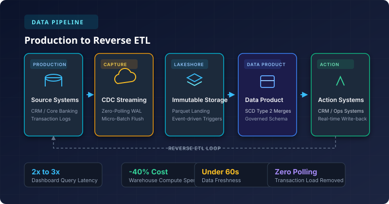

<h3>Executive Summary</h3>

Legacy batch ETL tools (Matillion) periodically queried our production operational databases with heavy SQL scans, inducing database locks and introducing multi-hour data latency. At Sears Holdings, I spearheaded the migration to an event-driven <strong>Change Data Capture (CDC)</strong> streaming pipeline using <strong>AWS Database Migration Service (DMS)</strong>, <strong>Amazon S3</strong>, and <strong>Snowpipe</strong>.

<figure class="media-figure">
  
  <figcaption class="media-caption">Architecture Diagram: Zero-Polling CDC Engine -> S3 Micro-Batches -> Snowpipe -> SCD2 Tables.</figcaption>
</figure>

<h3>1. Architecture & Engineering Decisions</h3>
<ul>
  <li><strong>Zero-Polling Replication:</strong> AWS DMS reads database transaction logs (WAL/Oplogs) directly without touching database query engines, eliminating CPU spikes on transactional services.</li>
  <li><strong>Micro-Batching to S3:</strong> DMS flushes changes in micro-batched Parquet files to an S3 staging bucket.</li>
  <li><strong>Automated Snowpipe Ingestion:</strong> S3 event notifications trigger Snowpipe, continuously ingesting records into landing tables within seconds of occurrence.</li>
  <li><strong>Stream & Task Merges (SCD Type 2):</strong> Snowflake Streams track new insertions and deletions, while scheduled Tasks execute high-performance MERGE operations to maintain historical dimensions.</li>
  <li><strong>MongoDB NoSQL Extraction:</strong> Engineered Python ETL pipelines extracting unstructured data from MongoDB NoSQL databases into refined relational models.</li>
</ul>

<h3>2. Measurable Outcomes</h3>
<ul>
  <li><strong>Query Latency:</strong> Dashboard query response times improved by <strong>2x to 3x</strong> due to indexing, clustering, and pre-clustered SCD2 tables.</li>
  <li><strong>Cloud Spend Reduction:</strong> Decreased Snowflake compute consumption by <strong>40%</strong> by eliminating full table re-scans.</li>
  <li><strong>Data Freshness:</strong> Reduced operational data lag from 6 hours to <strong>under 60 seconds</strong>.</li>
</ul>
